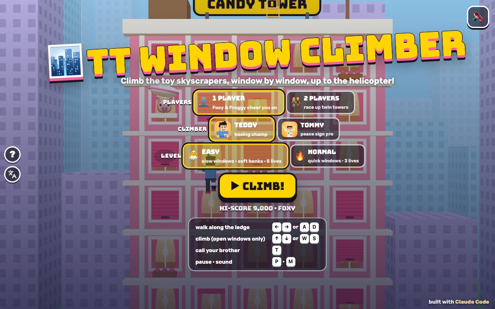

# TT Window Climber

Press **?** any time (or tap the round **?** button on the left edge) to see the keys. The game waits while you look.
Tap the language button under it (the A文 icon) to switch between English and 中文; the dashboard and every game remember the choice.

**中文：** 摩天楼攀爬：一个窗户一个窗户往上爬，爬上四栋玩具摩天楼！只能从开着的窗户爬，窗户关了就等一等或者换一个；住户探出头扔枕头、沙滩球、小黄鸭时快躲开；爬到楼顶坐直升机去下一栋楼。

A 3D arcade climbing game for the boys, starring Teddy and Tommy. Climb up the outside of four tall toy skyscrapers, window by window. Windows slide shut now and then: wait, or move over. Friendly residents lean out and drop soft things (pillows, beach balls, rubber ducks) that bonk you a little, always with a warning first. A helicopter waits on every roof to fly you to the next building.

Built with Claude Code from plain JavaScript and Three.js on the shared Claude Games kit. The climbers are the kit's blocky Teddy and Tommy; Foxy and Froggy fly the helicopters and cheer. There are no image, model or audio files: every texture is painted on a canvas and every sound is synthesised. The name, the characters, the buildings and the sounds are our own; nobody gets hurt (a bonk makes you dizzy for a moment, and the pillow puffs feathers).

## Play

- **Double-click `index.html`.** It works offline because Three.js and the kit are copied into `kit/`. Without internet the title font falls back to Arial Black.
- **Send one file:** `dist/window-climber-tt.html` is the whole game in one page, about 830 KB. AirDrop or email it, then open it in a browser.
- Rebuild that file after any edit: `python3 kit/tools/bundle.py . --name window-climber-tt`

On the title screen pick **1 PLAYER** (then the climber: Teddy or Tommy) or **2 PLAYERS** (a race up twin towers, side by side), the level, and press **▶ CLIMB!** Behind the menu the autopilot plays a demo.

**Levels:**

- **🐣 EASY** (the default, for Tommy, 5): windows shut slowly (2.4 s to slide down), soft bonks (dizzy for half a second, you stay on your ledge), a long warning (1.8 s) before anything drops, one thing at a time, and 5 lives.
- **🔥 NORMAL** (for Teddy, 8): windows shut fast, a bonk knocks you down a floor, shorter warnings (1.2 s), up to two things at once, more often on the taller buildings, and 3 lives.

An extra life comes every 10,000 points (1 player).

## Climbing

- **Walk** along the ledge with ← →. Let go and you settle in front of the nearest window.
- **Climb** with ↑: left hand, right hand, and you're on the next ledge. You can only climb through an **open** window, the one just above you. It has a **green frame**; a **red frame** means it's shut: wait for it, or walk over to another one.
- **Shutters** (pink stripes) slide down and roll up again. Grey shutters with 💤 stay shut: a sleepy resident is in there. Every floor always has at least one window that stays open, so there's always a way up.
- **A window that shuts while you're on it** slides you gently back down to the ledge (WHOOPS! WHEEE!). It never costs a life and never traps you.
- **On the wall**, ↓ climbs back down, and ← or → takes you to the nearest ledge and then walks.
- **Heads up!** A resident (🐰 🐻 🐱 🐶 🐷) leans out of a window above with a ❗ and something soft, and a dark **shadow** shows on the wall where it will come down. Step aside! A bonk costs a life (in 1 player); one that misses you right next to you is +50 MISSED ME!
- **The roof:** the helicopter lowers its rope ladder, you grab on, and it flies you to the next building. Four buildings: **CANDY TOWER** (10 floors), **MINT HEIGHTS** (12), **SUNNY SPIRE** (14) and **STARRY SKYSCRAPER** (16, at dusk).

**Points:** +50 for every new floor, +50 for a near miss, +100 for the brother's treat, and the building's **BONUS** (it counts down slowly; whatever is left is yours on the roof). **HI-SCORE:** the HUD shows the best for the level; the **TOP CLIMBERS** board keeps the best five, with 🦊 Foxy and 🐸 Froggy's scores to beat.

## 2 players

Teddy and Tommy race up twin towers side by side, each with his own half of the screen and his own camera. The twin towers have the same windows, opening and shutting at the same moments, so the race is fair. The first one on the roof gets **+2000** and a 🏆, and does his signature move while he waits for his brother; then both helicopters fly on. In the race a bonk costs time, not a life. After four buildings the higher score wins.

## Controls

| | Keys (1 player: either set) | Touch |
|---|---|---|
| walk along the ledge | ← → (2 players: Tommy) · A D (2 players: Teddy) | ◀ ▶ |
| climb up or down (only through an open window) | ↑ ↓ · W S | ▲ ▼ or the big CLIMB button |
| call your brother (2 players: high five) | T | tap his face (2 players: ✋) |
| pause · sound | P or Esc · M | ❚❚ · 🔊 |

- **Touch:** in 1 player an arrow cross on the left and a big **CLIMB** button and your brother's face on the right. In 2 players each brother gets a row of ◀ ▲ ▶ under his tower and the ✋ in the middle is the high five. They show up on phones and tablets, clear of the kit's buttons on the left edge.
- **Menus:** on the title screen 1 and 2 pick the players, E and N the level, C (or ← →) swaps the climber, Enter or Space starts. Paused: P, Esc or Space go on, Q goes to the menu. Results: Enter plays again, Esc goes to the menu.

## Call your brother (companion mode)

Call the other brother (`Kit.roster.buddyFor`: Tommy for Teddy, Teddy for Tommy) with **T**, by tapping his face button, or by clicking his face under your score, **as often as you like**: there's no waiting.

- **He pops in on a little cloud** next to you at his roster `buddyScale`.
- **He does his signature move:** Tommy's Y with peace fingers ✌️; Teddy's boxing, or (on the next call) his jump shot with a 🏀.
- **He tosses you a treat** (🍦 💧 🧃 🍪 🍉 🍌, a different one each call): +100.
- **Then the game's helper:** "TOMMY SAYS: I'LL HOLD THE WINDOWS!" Every window on the building slides open and stays open for 5 seconds, even the sleepy grey ones, with little ✋ hands holding them. Calling again starts the 5 seconds again.
- **2 players:** both brothers are climbing, so T is a **HIGH FIVE! ✋** (+50 each).

## The end

On the fourth roof (or when the lives run out) the winner, in 2 players the higher score, does his signature move with confetti: on the last roof with the helicopters, or on the street. The results show the score, the **TOP CLIMBERS** board (**⭐ NEW HI-SCORE!** or **⭐ ON THE BOARD!**) and **↻ PLAY AGAIN**.

## How it works, and how it's tested

- `js/levels.js`: the four buildings (size, how many windows shut and stay shut) and each one's window layout from a seed. `js/sim.js`: the rules, in fixed 1/60 s steps: walking, climbing hand by hand, the windows' shutters, the residents and their drops, bonks, the helicopter, points, lives, the race and the brother's visit. `js/bot.js`: the autopilot. None of them uses Three.js, so node runs them.
- `js/art.js` builds the city, the towers (instanced shutters, merged frames and ledges), the helicopter, residents and the soft things; `js/sfx.js` the sounds (all through `Kit.sound`, so the mute switch covers them; counted in `WC.sfx.log`); `js/game.js` the cameras (one per tower, side by side in 2 players), screens, keys, touch, HUD, celebrations and the test hooks. `js/friends.js` adds 🦊 Foxy and 🐸 Froggy to the roster (copied from TT Barrel Climb). The name lives in `js/title.js`.
- **The headless check:** `node tools/check.js` (or `game.check()` in the page), 8 checks in under a second:
  - *climbOnlyOpen:* on every building and both levels, ↑ under a shut, shutting or opening window never climbs (it knocks), and under an open one it does; then in long autopilot runs and random-key runs on both levels, every one of about 6,000 climbing steps went through an open window.
  - *shutNeverTraps:* a window that starts to shut while he's 20 %, 50 % or 80 % of the way up slides him back to his ledge in under 1.4 s, costs no life, and then he walks and climbs the next open window, on every building and level; random keys with very busy windows never leave him unable to walk or stuck on the wall; every window row has an always-open window.
  - *autopilotEasy:* the autopilot climbs all four buildings on 🐣 EASY on four seeds (about 80 s each, 0 or 1 bonk); NORMAL is reported too.
  - *warningFirst:* in long runs on EASY, NORMAL and 2 players (about 130 drops), every falling thing first leaned out with its warning for the full warning time, and nothing ever fell without one.
  - plus the brother's hold (treat +100, every window open for the whole 5 s, a stay-shut window climbed while he holds it and shut again after, four calls in a row), bonks (EASY: a life, no fall; NORMAL: a life and a floor; 2 players: no life), the helicopter (roof → next building's street → the fourth roof wins) and the 2-player race (four races finish, twin windows identical).
  - **It can fail:** `node tools/check.js --fail` (or `game.checkFail()`) switches on five sabotages one at a time (climbing through shut windows, a shutter that freezes him on the wall, an autopilot that stands still, drops with no warning, a hold that does nothing) and every one is caught.
- **The real-key play check:** `game.playCheck()` in the page (113 checks, about 1.4 s) presses keys with real `keydown`/`keyup` events on `window` and taps the touch buttons with pointer events, never the autopilot. On all four buildings, for Teddy and Tommy in 1 player and for both towers in 2 players (W A S D and the arrows each move only their own climber), with keys and with touch: → moves right and ← moves left on screen, ↑ climbs up the screen (measured against the building, since the camera rides along) through an open window and ↓ back down, and ↑ at a shut window doesn't move him. Nothing leaves him stuck: a window shutting while ↑ is held (EASY and NORMAL), the middle of the wall (↓, ← and → all get him off), a bonk, the brother's hold, keys held through pause, the helicopter to the next building, one brother finishing first in 2 players, and a "keyboard kid" mashing keys with things dropping on every building, 1 and 2 players. `game.playCheck('mirror')` (left and right swapped) fails 41 checks and `game.playCheck('stuckWall')` (↑ ↓ ignored once on the wall) fails 38.
- **In the browser** (headless Chrome over the DevTools protocol, `tools/shoot.js` with the step files in `tools/`, the page opened from the disk): every screen in 中文 (`Kit.lang.untranslated()` returns `[]` on the title, the ? panel, ready, the brother's hold, the knock, the slide, warnings, bonks, a near miss, pause, the roof and the helicopter, the next building, an extra life, game over, the 2-player high five and first place, and both results), no Chinese in English mode or in the English ? panel, sounds counted in code while muted, the ? panel freezing the game with real frames, phone 390x844, 740x360 and 844x390, and iPad 1024x768, 820x1180 and 1180x820 with touch in 1 and 2 players (no scrolling, no button over another or the kit's left-edge buttons, the tower around the climber clear of the HUD and the touch buttons, the smallest tap target 49 px), and `dist/window-climber-tt.html` from `file://` with the network blocked (it boots, real frames run, the ? panel freezes it, and the play check and the headless check pass there too).
- `docs/screenshot.jpg` is the title at 1200x750: `node tools/shoot.js tools/shots.json docs 1200 750`.

## Not verified

- **Sound:** every sound is synthesised and counted in code, but nobody has listened to it (tests ran muted): the hand-over-hand clicks, the shutter zip, the flump, boing and squeak of the bonks, the helicopter.
- **Real devices:** touch was driven with synthetic pointer events in emulated phones and iPads, not on a real iPad or iPhone. The frame rate was only seen in software rendering (about 115 draw calls a frame in 1 player), not on an older iPad. 2 players on a phone in portrait is small (each tower gets half the width); an iPad or a phone held sideways is better.
- **Real kids:** how hard Easy and Normal feel was tuned with the autopilot, not with Teddy and Tommy. The autopilot doesn't dodge while it's on the wall, and on NORMAL it sometimes runs out of lives on the third building.
- **Long sessions,** a real Finder double-click, the home-screen icon on a real iPad, and the offline font fallback.
